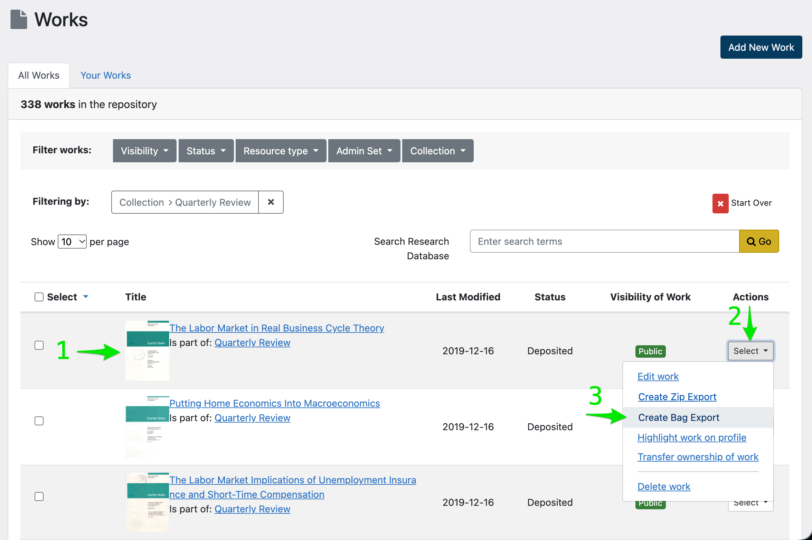
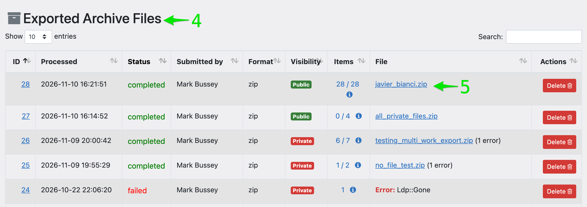
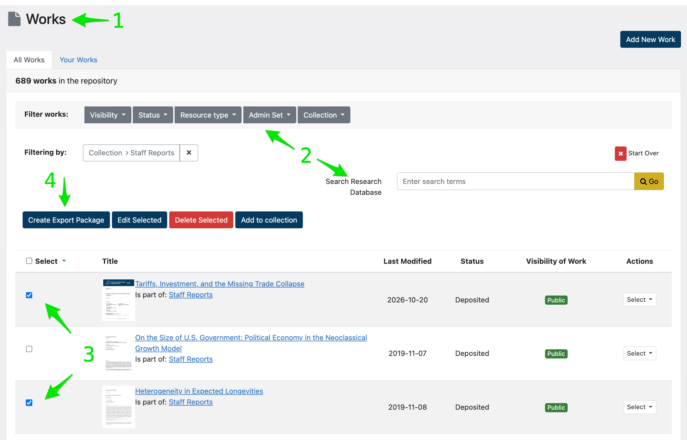
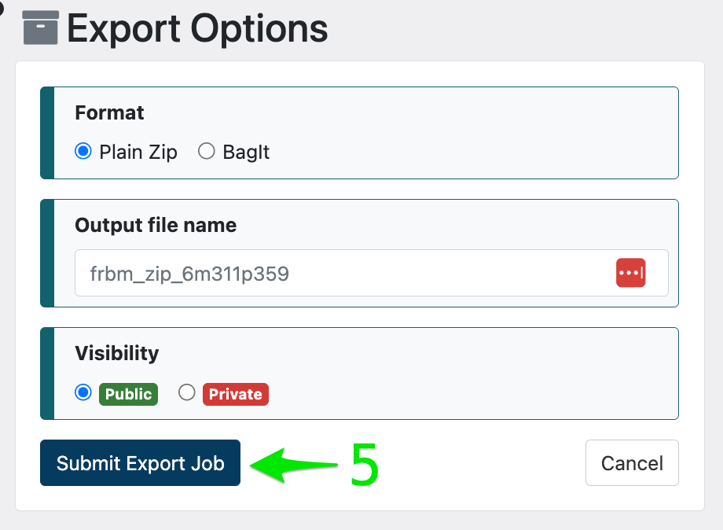
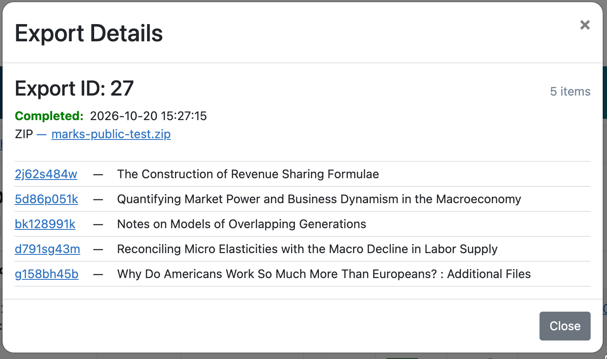

# Exports
Exporting content from the Research Database in BagIt or plain ZIP format.


## Overview
The Export feature allows administrators to select one or more works from the repository and package the files and 
metadata into a single downloadable compressed `.zip` archive. Two formats are available:

| Format  | Best for                 | What you get                  |
|---------|--------------------------|-------------------------------|
| **ZIP** | Sharing with researchers, colleagues, or the public                  | A folder for each work, its files, and a `metadata.csv` spreadsheet <br> *see* [ZIP Structure](#zip-structure)                              |
| **Bag** | Preservation, transfer to external systems, and automated processing | Everything in a ZIP export, plus checksums and per-work JSON metadata in the standard BagIt layout <br> *see* [Bag Structure](#bag-structure) |

* You can select and export works from the **Works** page in the administrator dashboard.
* You can search and manage zipped archives from the **Exports** page in the dashboard.
* You can download an exported archive using a download link that lets you copy the zipped archive 
  to your local system or another system.

**NOTE:** The export functionality is restricted to administrators. Users will need to log in to download
archive files. Only public ZIP exports can be downloaded without logging in.


## Getting Started

RDB provides two methods to export works in the repository:

**Single-work export:** Creates an archive containing the files and metadata for a single Publication, 
Conference Proceeding, or Dataset.
1. Find the work in the **Works** page in the admin dashboard.
2. Click the "**Select**" button in the Actions column.
3. Click the "**Create Zip Export**" or "**Create BagIt Export**" link from the Select menu in the Actions column.
   

4. Your request will be submitted for background processing, and you will be redirected to the **Exports** page where 
   you can view the status of your request.
5. Once the background job is done and you refresh the page, you will see a link to download your new archive.  
   

   > **NOTE:** Single-work archives use the default filename.
   > They have the same visibility as the work.
   > * If the work is public, the export will be public.
   > * If the work is private, the export will be private.

**Multiple-work export:** Creates an archive containing the files and associated metadata for one or more works. 
The process is very similar to single-work export, except that you can use the work selection checkboxes on the 
Works page to select more than one work at a time.
1. Open the **Works** page in the admin dashboard.
2. Use the *Filter*, *Search*, and *Pagination* options to show the works you want to export.
3. Click the checkbox next to each of the works you want to include in your archive.
4. Click the "**Create Export Package**" button just above the list of works.
   

5. Next, the **Export Options** page will appear. You can accept the defaults, or change the filename, format, 
   and/or visibility. Once you have the options you want, click the "Submit Export Job" button.  
   

 6. Your request will be submitted for background processing, and you will be redirected to the 
    **Exports** page where you can view the status of your request.
 7. Once the background job is done and you refresh the page, you will see a link to download your new archive file.


## Choosing visibility
The visibility you choose controls which works and files are included in your export.

| Export visibility | Works and files included | Who can download |
|---|---|---|
| **Public** | Public only | *ZIP:* Anyone with the link, signed in or not <br> *Bag:* Administrators only |
| **Private** | Public, FRBM, and Private | Administrators only |

- Work and file visibility are checked independently. If a work does not meet the export visibility level, the work and
  all of its files are left out. If a work is included, each file is checked independently; only files meeting
  the visibility criteria are included.
- If a work is included, it will get a row in `metadata.csv`, even if it has no files that meet visibility criteria.
- If a file is included, it will get a row in `metadata.csv`.

## Tracking and managing exports
Click **Exports** in the dashboard sidebar to open the **Exported Archive Files** page. 
Each export shows:

- **ID** and **Items**: click either one to see the works selected for the export.
- **Processed:** when the export last changed status.
- **Status:**
    - *queued*: waiting to start.
    - *working*: being built.
    - *completed*: ready to download.
    - *failed*: something went wrong, and no file was created.
- **Submitted by:** the administrator who created the export.
- **Format:** zip or bag.
- **Visibility:** the visibility level of items included in the export (see [Choosing visibility](#choosing-visibility)).
- **File:** the download link, shown once the export completes.
- **Delete:** available once the export is no longer queued or working.

### Export management
* Export jobs can be sorted and filtered by any of the attributes displayed in the columns. Just click on the 
  sorting arrow next to the attribute name.
* Items in a particular bag can be displayed by clicking on the item count or ⓘ (info) icon. 
  This will cause a pop-up to display details about the export, including the ID and title of each included work.

  

* You can search for bags with a specific work in them by pasting the work's ID in the search box on the Exports page.
* You see an alert when creating multi-item exports with the same item IDs as an existing export. You can choose
  whether to proceed or cancel the export.
* If you make modifications to a work after it has been bagged, the bagged version will not be updated. 
  If you want an updated bag, you will need to delete the original export and re-bag the updated work(s).


## The metadata.csv spreadsheet
Both formats include `metadata.csv` at the top level of the export.

- Each included work has *one metadata row*, followed by *one row for each of its included files*. Each work is
  separated from the previous work and its files by a blank row.
- Works are listed **in order of work ID**, not in the order you selected them. A work's files follow
  the file order shown on the work page.
- Fields with more than one value (titles, creators, and so on) are separated with `|`.
- Dates use the format `YYYY-MM-DD`. "Date Created" uses whatever format was entered in the work's metadata.

| Column | Work row | File row |
|--------|----------|----------|
| `internal_id` | Work ID | ID of the work the file belongs to |
| `member_id` | (blank) | File ID |
| `type` | Work type (`Publication`, `Dataset`, `ConferenceProceeding`) | `File` |
| `visibility` | Public / FRBM / Private | Public / FRBM / Private |
| `representative_id` | ID of the work's representative file | (blank) |
| `title` | From the work's metadata | Original filename or later manual edit |
| `creator`, `corporate_author`, <br/>`date_created`, `date_modified`, `identifier`, <br/>`series`, `issue_number`, `collection`, <br/>`abstract`, `table_of_contents` | From the work's metadata | (blank) |
| `date_uploaded` | Date the work was uploaded | Date the file was uploaded |
| `location_url` | Link to the work page | Link to download the file |
| `filename` | (blank) | Originally uploaded file name |
| `path` | (blank) | Path to the file, relative to the export folder (ZIP) or its `data/` folder (Bag), e.g., `abc123/1/wp345.pdf` |
| `error` | The work-level error that occured, if any, or <br/>(blank) | The file-level error that occurred, if any, or <br/>(blank) |


## ZIP Structure
The ZIP export format is a simple directory structure that contains all the files and metadata for the selected works.
It is a lightweight alternative to BagIt exports, targeted toward sharing with researchers, colleagues, and the public.
- Each work gets a folder named after its **work ID**, the code at the end of the work's web address.
- A work with **one** file has that file directly inside its folder.
- A work with **several** files has each file in its own numbered folder: 1, 2, 3, and so on.
    - Numbering reflects the order shown on the work's page in the browser.
    - Numbering only counts files that are in the export. Files left out by visibility filtering don't
      take up a number.
    - Numbers are padded with leading zeros as necessary to preserve the correct sorting order.
- Files keep their original file names. (Two files with the same name may be attached to a single work; they will have
  different subfolder numbers.)
- Only a work's own files are exported. Child works are not included in their parent's folder.
```
my_export/
├── metadata.csv
├── abc123/                 ← a work with one file
│   └── sr887.pdf
├── def456/                 ← a work with several files
│   ├── 1/
│   │   └── wp345.pdf
│   ├── 2/
│   │   └── appendix.pdf
│   └── 3/
│       └── source_data.csv
└── ghi789/                 ← a work with 10 or more files
    ├── 01/
    │   └── readme.txt
    ├── …
    └── 12/
        └── fiscal_data.xls
```


## Bag Structure
Bags conform to the [BagIt specification](https://www.rfc-editor.org/rfc/rfc8493); however, the standard is meant to be
very flexible, so there are still a number of choices unique to each local implementation. 
In particular, we have made the following decisions:
* Works are identified by their 9-character Repository ID.
* There is a top-level tag file named `metadata.csv` which contains a subset of metadata for each item in the bag.
* Files attached to each work are in a unique directory under the `data` directory.
    * Each work folder is named using the work's Repository ID - i.e. files for the work accessed via
      https://researchdatabase.minneapolisfed.org/concern/publications/2j62s5134
      will be in the directory named data/2j62s5134.
* The full metadata for each work is serialized to JSON and stored in a tag file in the `metadata` directory.
    * Each metadata file is named using the work's Repository ID.
* Directory contents are not inherently ordered; file and subdirectory names are conventionally sorted lexically.
* The downloadable zip file defults to using the ID of the first work in the bag to generate names. A different
  filename can be specified in the export options.

**EXAMPLE**

For a bag containing IDs 9880vq965, bg257f046, and qj72p712h, the structure would look like this:
```
archive_root/
├── bag-info.txt
├── bagit.txt
├── data                            // One subdirectory for each work included in the bag
│   ├── 9880vq965                   // Directory name uses the Repository ID
│   │   └── AK-Page-4.pdf           // Exact binary copy of each file attached to the work
│   ├── bg257f046
│   │   └── Samvera_Camp_-_tent.png
│   └── qj72p712h
│       └── 2-C%C5%93urs-Recto.tiff
├── manifest-sha256.txt             // We use SHA-256 checksums, one checksum for every file in data/
├── metadata                        // Metadata tag file directory  
│   ├── 9880vq965.json              // One file for each work
│   ├── bg257f046.json              // Name uses the repository ID
│   └── qj72p712h.json              // All available metadata serialized to JSON
├── metadata.csv                    // Custom tag file with one row per work in bag, contains subset of common metadata
├── tagmanifest-md5.txt
└── tagmanifest-sha1.txt
```

## Sharing download links
The **File** link on the Exports page can be shared. Whether someone can open it depends on the format
and visibility rules above. People who aren't allowed see a "page not found" error.

Users will need to be logged in to download BagIt archives and private ZIP archives. Only public ZIP exports 
can be downloaded without logging in.
